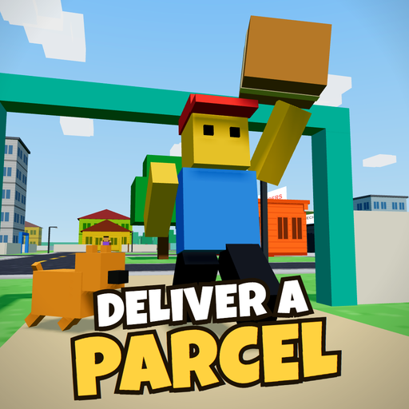

# Deliver a Parcel

> **This browser version is the prototype.** Deliver a Parcel is now being built as a Roblox game:
> <https://github.com/KoolDudeGameDev/food-delivery-roblox>. This version stays playable.



A blocky 3D delivery game that runs in your browser, on a computer or a phone. Start with a
cardboard box, deliver food and parcels against the clock, and build it up into a mansion.
Watch out for the dogs.

**Play it now: <https://deliver-a-parcel.vercel.app>**

## How it plays

- Each time you open the game, pick your name, skin, shirt, pants and cap, then press Play.
- Choose an order from the board at the hub, the green dot on the minimap, then follow the yellow
  dot. Each one shows its difficulty, from 1 to 5 stars. Good ratings unlock harder orders.
- Food pays better when it's fast. Parcels are heavy and slow you down.
- Yards have chasers, from a quick little Chihuahua to a Great Dane, plus cats and geese. You always
  walk through a gate, so the chase stays on foot.
- Some parcels go to the cemetery. Park at the gate and find your way between the tombs to the
  right grave.
- Citizens walk the sidewalks, and jeepneys and tricycles drive the rings. Hit a citizen or get hit
  by traffic and it costs you.
- After dark, deliveries pay 15% more. The graveyard has candles lit, and something else is out
  there too.
- At night, dealers offer shady packages for big money. Police will chase you while you carry one,
  and getting caught costs 25% of your cash and all your orders.
- Rain, brownouts, fiestas and Undas come and go, and each changes the pay or the danger.
- Three daily goals, delivery streaks and regular customers all pay extra.

Spend your cash around town:

- **Vehicle dealer** (orange dot): roller blades, skateboard, bicycle, moped, motorcycle, tricycle.
- **Mechanic** (teal dot): bigger wheels, baskets, sidecars and paint for your ride.
- **Home** (blue dot): house upgrades, paint and garden items. All of it is on sale from the start.

| Action | Keyboard and mouse | Phone |
| --- | --- | --- |
| Move | WASD or arrow keys | Left thumb |
| Look | Drag | Right thumb |
| Sprint | Shift | SPRINT |
| Jump | Space | JUMP |
| Open the order board, a shop or your home | E | ACTION |
| Mute | M, or the Sound button | Sound button |

Your progress saves in your browser, so it doesn't follow you to another device.

## Multiplayer

Up to seven players can share one world. You see each other riding around, each home shows its
owner's upgrades and paint, and the order board lists everyone in the world by what they're worth,
with their star rating. Nothing is stored on the server. Orders and dogs stay separate for each
player.

The public link is single-player until a server is running. To start one, install the
[Fly.io CLI](https://fly.io/docs/flyctl/install/), then run this from `server/`:

```sh
fly launch --copy-config --no-deploy
fly deploy
```

Then put the server's address in `MULTIPLAYER_URL` in `src/config.js`, for example
`wss://your-app-name.fly.dev`.

To try it locally, run `npm install` and `npm start` in `server/`, then open the game with
`?server=ws://localhost:8080` added to the address.

## Run it locally

You need [Node.js](https://nodejs.org). From this folder, run:

```sh
npx serve -l 3000
```

Then open <http://localhost:3000>. On Windows you can double-click `start.bat` instead. Opening
`index.html` directly won't work, because browsers block the module import from `file://`.

## How the code is laid out

There's no build step and no dependencies to install. It's plain JavaScript modules that the
browser loads directly, so you edit a file and refresh.

```text
index.html          page markup: HUD, touch buttons, dialogs
css/style.css       all styling
vendor/             unmodified three.js r170
assets/sfx/         sound clips, with their sources in CREDITS.md
server/             the multiplayer server
src/
  main.js           starts the game and runs the frame loop
  config.js         tuning numbers, dog sizes and breeds
  data/
    vehicles.js     vehicles, their upgrade parts and models
    homes.js        the house ladder and models
    orderTypes.js   fragile, rush, bulky and normal orders
    cosmetics.js    paint, clothes and garden items
  engine.js         renderer, scene, lights, and world-building helpers
  world.js          the map: roads, houses, home sites, trees
  daynight.js       the day-to-night cycle
  player.js         the player character
  dogs.js           dog behaviour
  citizens.js       people walking the sidewalks, some with dogs
  ghost.js          the White Lady
  orders.js         taking and delivering orders
  home.js           your home, upgrades, and riding
  board.js          the order board
  shop.js           the panel for home, dealer and mechanic
  actions.js        what the action button does where
  goals.js          daily goals, streaks and regular customers
  events.js         rain, brownouts, fiesta and Undas
  traffic.js        jeepneys and tricycles
  net.js            multiplayer
  intro.js          the intro: your name and look, then Play
  hub.js            the conveyor in the orders building
  contraband.js     night jobs
  police.js         police cars and arrests
  audio.js          sound effects
  save.js           saved progress
  input.js          keyboard, mouse and touch
  movement.js       moves the player each frame
  camera.js         the follow camera
  hud.js            cash, stamina, order card, hints
  minimap.js        the minimap
  state.js          the few values several files share
  util.js           small helpers
```

Most new content is one new row in a table. Add an order type in `src/data/orderTypes.js`, or a
sound in `src/audio.js` with a line in `assets/sfx/CREDITS.md`. Add a dog breed in `src/config.js`, then give it to a
house in `src/world.js`. Add a vehicle or part in `src/data/vehicles.js`, or a house level in
`src/data/homes.js`.

## Contributing

Friends and strangers are both welcome.

`main` is protected, so every change goes through a pull request and needs one approval.

1. Fork the repo, or ask for access, and make a branch.
2. Make one change at a time, and keep it to one pull request.
3. Play it at desktop size and at phone size before you open the pull request.
4. Check the browser console has no errors, and say in the pull request what you tested.

Once a pull request is merged, it goes live on its own. Vercel also builds a preview of each pull
request, but previews are private to the project's Vercel team, so test on your own machine.

Keep it simple: no build step, and no new dependency for something a few lines can do.

Good places to start:

- More sound effects
- More vehicles and parts
- More things that chase you
- Balancing prices, timers and pay
- Sharing dogs and orders between players

## License

The code is [MIT](LICENSE). The bundled three.js is also MIT, with its copyright notice kept at the top
of `vendor/three.module.js`. Sound clips have their own terms: see `assets/sfx/CREDITS.md`, because two
of them aren't covered by the MIT license.
